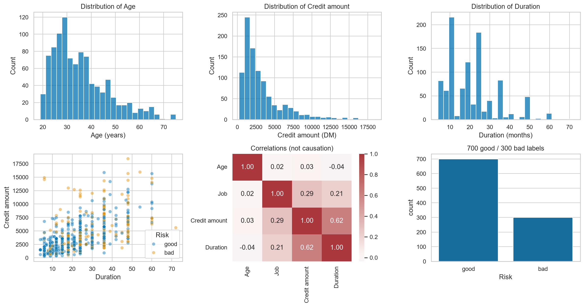
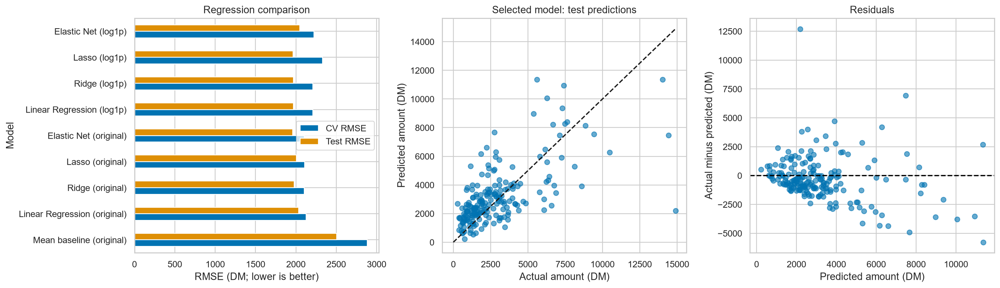
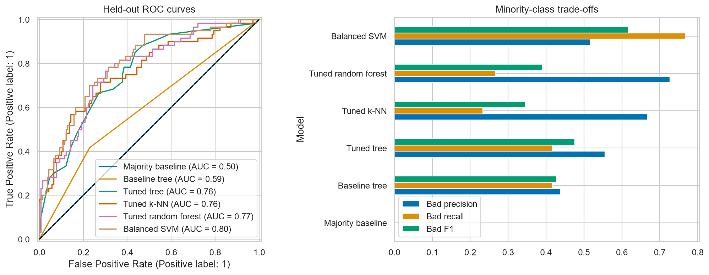
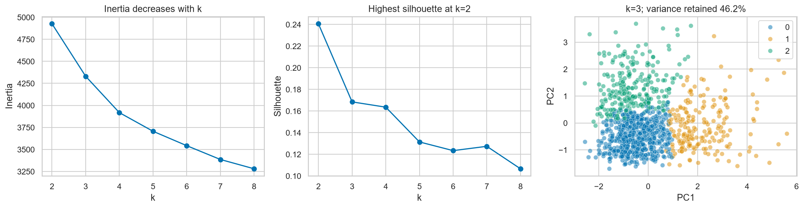
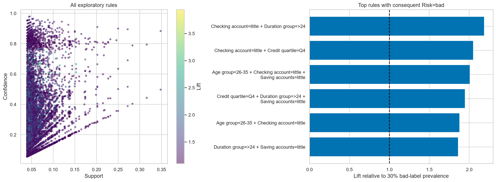

# MSCS-634 Project — Deliverable 4

**Team:** Minh Le, Sebastian Capkovi, Shreyas More, Elkana Munganga  
**Course:** Advanced Big Data and Data Mining | Fall 2026

One consolidated, executed notebook integrates the first three deliverables. The comprehensive Word report and PowerPoint slides with speaker notes are included. The 5–7 minute video still needs to be recorded.

## Start here
[PowerPoint presentation](MSCS_634_Presentation.pptx) — 11 slides with an approximately 6 minute 30 second script. Each slide includes timing, narration, presenter cues, and source notes in its Notes pane.

[Comprehensive written report](MSCS_634_Comprehensive_Report.docx) — findings, visualizations, recommendations, ethics, and references.

Open [MSCS_634_Final_Analysis.ipynb](MSCS_634_Final_Analysis.ipynb). Saved outputs allow review without rerunning. All analysis code is included in the notebook.

## Dataset and why it was selected
The German Credit derivative contains 1,000 historical applicants and nine predictors: Age, Sex, Job, Housing, Saving accounts, Checking account, Credit amount, Duration, and Purpose. Its manageable size, interpretable features, and mixed numeric/categorical structure support EDA, regression, classification, clustering, and association mining. Regression predicts credit amount in historical Deutsche Mark (DM); classification predicts UCI good/bad risk labels (700 good, 300 bad).

All nine shared attributes and the risk labels are checked against the bundled UCI source file. The derivative omits 11 original predictors, and this historical sample is not representative of present-day lending. Risk labels do not specify a modern default event or prediction horizon. See the [data dictionary](data/README.md).

## Project steps
1. Combine the three earlier deliverables into one documented workflow.
2. Remove the export index; retain missing account categories; check duplicates, valid ranges, shared attributes, and labels.
3. Explore distributions, skewness, purpose, correlation, and class imbalance.
4. Engineer squared age/duration and duration × job; compare regression pipelines and log targets with training CV.
5. Compare tree, k-NN, forest, and SVM classifiers with stratified training CV and minority-class metrics.
6. Compare k=2–8 clusters; retain k=3 profiles for continuity; assess hierarchical agreement and PCA visualization.
7. Mine credit-quartile/age/duration transactions with Apriori and FP-Growth; compare itemsets and report rules with counts.
8. Audit subgroup errors; synthesize recommendations; export figures and tables, and summarize the findings in this README.

## Major findings
- **Preparation:** 1,000 applicants; nine shared attributes and all risk labels verified. Savings/checking missing counts before cleaning: 183/394. Duplicates: 0.
- **EDA:** Mean credit amount 3,271.3 DM; original/log skewness 1.95/0.13; duration–amount correlation 0.625.
- **Regression:** CV selected **Elastic Net (original)** (CV RMSE 2,102.2 DM). Test R² **0.369**, RMSE **1,959.4 DM**, MAE 1,351.4 DM. Errors remain substantial; these are not affordability estimates.
- **Classification:** CV selected **Tuned random forest** (CV AUC 0.758). Test AUC **0.774**, accuracy 75.0%, bad-class recall **26.7%**, precision 72.7%. Compare against 70% majority accuracy; accuracy alone hides missed bad labels.
- **Clustering:** Highest silhouette **0.241 at k=2**; k=3 silhouette 0.168; K-Means/hierarchical ARI 0.408. Weak separation limits claims of intrinsic borrower groups.
- **Association rules:** Both algorithms return **1,520 itemsets**, yielding 7,796 rules at lift ≥1.1. Top bad-label rule: `Checking account=little + Duration group=>24` → `Risk=bad`, support 4.2%, confidence 65.6%, lift 2.188; 42 joint matches among 64 antecedent matches. This is an in-sample association.
- **Ethics:** Subgroup errors and denominators are reported; fairness, causation, and modern deployment readiness are not established.


## Regression results
Fresh results use corrected fold-specific preprocessing and explicit search grids. Selection uses training CV RMSE, not test scores. CV results are tuning estimates, not nested CV. RMSE/MAE are in DM; MSE is in DM²; R² is unitless.

| Model | CV RMSE | CV RMSE SD | CV R2 | Train R2 | Test R2 | Test MSE | Test RMSE | Test MAE |
|---|---|---|---|---|---|---|---|---|
| Mean baseline (original) | 2883.3089 | 323.8075 | -0.0113 | 0.0000 | -0.0328 | 6283631.8018 | 2506.7173 | 1903.8873 |
| Linear Regression (original) | 2128.0199 | 262.5984 | 0.4404 | 0.5024 | 0.3192 | 4142279.0611 | 2035.2590 | 1385.6462 |
| Ridge (original) | 2102.4168 | 263.4386 | 0.4557 | 0.4998 | 0.3559 | 3918441.4421 | 1979.5054 | 1361.1132 |
| Lasso (original) | 2110.3270 | 264.0791 | 0.4502 | 0.5009 | 0.3395 | 4018765.8366 | 2004.6860 | 1366.2302 |
| Elastic Net (original) | 2102.1741 | 262.0026 | 0.4561 | 0.4976 | 0.3689 | 3839416.8075 | 1959.4430 | 1351.3798 |
| Linear Regression (log1p) | 2209.8213 | 283.7568 | 0.3981 | 0.4542 | 0.3624 | 3879357.3219 | 1969.6084 | 1235.4989 |
| Ridge (log1p) | 2209.8476 | 283.7593 | 0.3981 | 0.4542 | 0.3623 | 3879550.8008 | 1969.6575 | 1235.5149 |
| Lasso (log1p) | 2328.6468 | 270.2306 | 0.3353 | 0.3526 | 0.3651 | 3862545.4822 | 1965.3360 | 1255.8530 |
| Elastic Net (log1p) | 2221.8677 | 286.7514 | 0.3905 | 0.4382 | 0.3096 | 4200130.6735 | 2049.4220 | 1255.6860 |

## Classification results
Positive class = bad. Selection uses training CV AUC. SVM scores are uncalibrated decision scores. Test predictions use default estimator decision rules.

| Model | CV AUC | CV AUC SD | Accuracy | Bad precision | Bad recall | Bad F1 | Weighted F1 | Test AUC | Average precision |
|---|---|---|---|---|---|---|---|---|---|
| Majority baseline | 0.5000 | 0.0000 | 0.7000 | 0.0000 | 0.0000 | 0.0000 | 0.5765 | 0.5000 | 0.3000 |
| Baseline tree | 0.5756 | 0.0572 | 0.6650 | 0.4386 | 0.4167 | 0.4274 | 0.6625 | 0.5940 | 0.3577 |
| Tuned tree | 0.7056 | 0.0479 | 0.7250 | 0.5556 | 0.4167 | 0.4762 | 0.7123 | 0.7602 | 0.5663 |
| Tuned k-NN | 0.7207 | 0.0322 | 0.7350 | 0.6667 | 0.2333 | 0.3457 | 0.6874 | 0.7612 | 0.6314 |
| Tuned random forest | 0.7578 | 0.0552 | 0.7500 | 0.7273 | 0.2667 | 0.3902 | 0.7070 | 0.7737 | 0.6175 |
| Balanced SVM | 0.7444 | 0.0425 | 0.7150 | 0.5169 | 0.7667 | 0.6174 | 0.7263 | 0.7990 | 0.6595 |

## Three-cluster profiles
IDs are arbitrary; Risk is added only after clustering. These are descriptive groups, not validated lending categories.

| Cluster | Applicants | Age | Credit_amount | Duration | Job | Bad_rate |
|---|---|---|---|---|---|---|
| 0.0000 | 562.0000 | 29.2295 | 2195.7295 | 17.2064 | 1.8754 | 0.2900 |
| 1.0000 | 192.0000 | 35.0365 | 7631.6042 | 38.5990 | 2.2917 | 0.4635 |
| 2.0000 | 246.0000 | 50.3740 | 2325.1626 | 15.5366 | 1.6667 | 0.1951 |

## Visual evidence






## Challenges and corrections
- Rebuilt one ordered workflow instead of concatenating reused variables and out-of-order sections.
- Verified every shared attribute before accepting positional risk labels.
- Moved encoding and scaling inside CV, including regression penalty selection.
- Used explicit regression grids and smaller classifier grids; original analyses are linked in the references for comparison.
- Corrected Unknown checking semantics: UCI A14 means no checking account. A65 savings means unknown/no savings account.
- Used actual credit quartiles, correcting inconsistent fixed thresholds in earlier prose; age bin labels now correctly include 25 in the first bin.
- Recomputed cluster profiles and rules, reporting the actual silhouette winner.
- Used all applicants for the hierarchy; a small illustrative subset cannot establish full-sample topology.
- Replaced unsupported causal/automatic approval/pricing recommendations with evidence-limited conclusions.

## Recommendations, ethics, and limitations
Use regression estimates with explicit error diagnostics, especially for large loans. For classification, compare missed bad labels and false alarms rather than accuracy alone. Clusters and rules are hypotheses requiring independent validation. No automatic lending decisions are supported by this exercise.

The sample is historical, geographically limited, and small. Age, sex, and socioeconomic predictors can encode historical discrimination; removing demographics alone does not eliminate proxies. The derivative's binary sex field simplifies the original combined personal-status/sex attribute. The notebook reports subgroup errors with denominators, but does not establish fairness or quantify subgroup uncertainty. No identifying personal information was added, and records should not be re-identified.

Implemented safeguards include verified labels, documented account semantics, fold-specific preprocessing, stratified splits, naive baselines, minority-class metrics, and subgroup diagnostics. Future work includes contemporary external validation, repeated/nested CV, uncertainty estimation, nonlinear regression, feature ablations, cluster stability, held-out rule validation, calibration, explicit decision costs, and intersectional fairness analysis. Prior deliverables already examined the benchmark test rows; this run is not a new blind external test.

## Reproduce
Python 3.13 was used. Exact direct dependency versions appear in `requirements.txt`.

```bash
python -m venv .venv
# Windows PowerShell:
.venv\Scripts\Activate.ps1
# macOS/Linux: source .venv/bin/activate
python -m pip install -r requirements.txt
python -m notebook MSCS_634_Final_Analysis.ipynb
```

Select the virtual environment kernel and Run All.

Runtime depends on hardware; searches use two workers. All required inputs are local. Running the notebook refreshes figures and creates a `results/` folder containing exported tables. Saved results and visualizations are already embedded in the submitted notebook.

## Submission files
```text
MSCS_634_Project/
  MSCS_634_Final_Analysis.ipynb  # Consolidated notebook with saved outputs
  MSCS_634_Comprehensive_Report.docx  # Comprehensive written report
  MSCS_634_Presentation.pptx     # Slides with timed speaker notes
  README.md                    # Dataset, project steps, and major findings
  requirements.txt             # Dependencies for running the notebook
  data/                        # Required inputs and data dictionary
  figures/                     # Visualizations referenced by the README
```

## References and attribution
- Hofmann, H. (1994). *Statlog (German Credit Data)*. UCI Machine Learning Repository. [doi:10.24432/C5NC77](https://doi.org/10.24432/C5NC77). UCI lists the dataset under CC BY 4.0.
- [Kaggle derivative used in Deliverable 1](https://www.kaggle.com/datasets/varunchawla30/german-credit-data).
- [Deliverable 1](https://github.com/elkana-m/CS-634/tree/main/project1): preparation and EDA.
- [Deliverable 2](https://github.com/sebcap7/MSCS_634_ProjectDeliverable_2): regression and feature engineering.
- [Deliverable 3](https://github.com/smore38997/MSCS_634_ProjectDeliverable_3): classification, clustering, association mining.

Original authorship is retained. No new license is imposed on upstream code.
