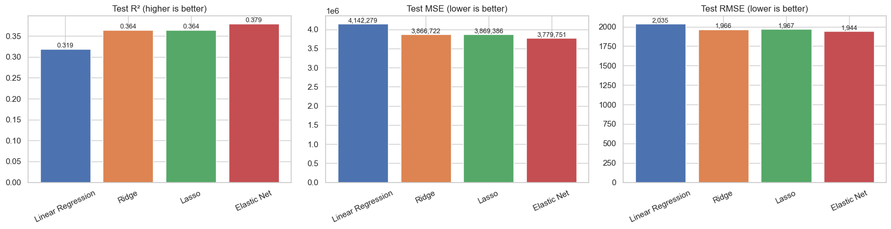
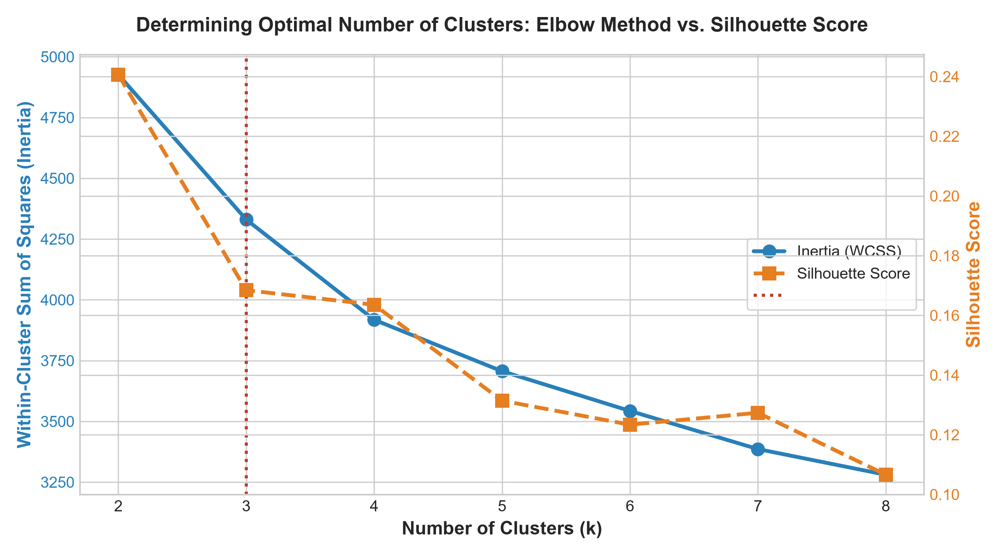

# MSCS 634 Project — Deliverable 4

**Team:** Minh Le, Sebastian Capkovi, Shreyas More, Elkana Munganga  
**Course:** Advanced Big Data and Data Mining | Fall 2026

## Submission files
- [Consolidated notebook](MSCS_634_Final_Analysis.ipynb): original code, comments, saved outputs, visualizations, final synthesis, and source caveats.
- [Comprehensive Word report](MSCS_634_Comprehensive_Report.docx).
- [PowerPoint with speaker notes](MSCS_634_Presentation.pptx): 12 slides.
- [Recorded presentation — watch on ScreenPal](https://go.screenpal.com/watch/cOX3oRn45iE).
- `data/`: local input files; `figures/`: selected original notebook images; `requirements.txt`: analysis dependencies.

No ZIP or build scripts are included.

## Dataset and project steps
The German Credit derivative contains 1,000 historical applicants, nine project predictors, and 700 good / 300 bad benchmark labels after the Deliverable 3 outcome integration. Mixed numeric and categorical features support all four analytical methods. Regression predicts credit amount in historical Deutsche Mark (DM); classification predicts the benchmark risk label. This is a historical educational dataset, not a validated modern lending population.

1. Deliverable 1: remove the export index, retain missing account categories, check duplicates/ranges, and explore distributions and correlations.
2. Deliverable 2: engineer Duration², Age², and Duration × Job; compare Linear, Ridge, Lasso and Elastic Net with original and log targets.
3. Deliverable 3: compare classifiers; examine K-Means and Ward clustering; mine association rules with Apriori and FP-Growth.
4. Deliverable 4: consolidate original evidence, explain limitations, and present recommendations and ethics.

## Evidence policy
The main results below now come from the **original saved notebook tables**, not the revised modeling run previously included in this repository. No notebook was executed for this alignment revision. Every original source cell and saved output is retained, with local data-path adaptations and added provenance/caveats. A later Run All may produce different results; this submission does not claim a fresh reproduction of inconsistent upstream outputs.

## Final synthesis using original saved results

Deliverable 1 retained 1,000 rows, filled 183 savings and 394 checking entries with Unknown, found no duplicate records, and reported duration–amount correlation 0.625. Mean credit amount is 3,271.26 DM.

### Deliverable 2 regression
| Model | Test R² | Test MSE | Test RMSE (DM) | Test MAE (DM) | CV RMSE (DM) |
| --- | --- | --- | --- | --- | --- |
| Linear Regression | 0.319 | 4142279.061 | 2035.259 | 1385.646 | 2128.02 |
| Ridge | 0.364 | 3866721.656 | 1966.398 | 1354.916 | 2105.289 |
| Lasso | 0.364 | 3869385.994 | 1967.075 | 1342.767 | 2116.589 |
| Elastic Net | 0.379 | 3779750.55 | 1944.158 | 1346.43 | 2103.606 |

Elastic Net has the lowest original reported test RMSE (1,944.158 DM) and test MSE (3,779,750.550 DM²). Original tuning reported alpha about 2.55 and l1_ratio 0.9. Its original CV RMSE is 2,103.606 DM. Regularization modestly improves the linear baseline; large-loan errors remain. The log-linear experiment lowers MAE to 1,235.499 DM but does not beat original-target Elastic Net on test RMSE.

### Deliverable 3 classification
| Model | Accuracy | Bad precision | Bad recall | Bad F1 | Test AUC |
| --- | --- | --- | --- | --- | --- |
| Baseline tree | 0.665 | 0.4386 | 0.4167 | 0.4274 | 0.594 |
| Tuned tree | 0.725 | 0.5556 | 0.4167 | 0.4762 | 0.7602 |
| Tuned k-NN | 0.735 | 0.6667 | 0.2333 | 0.3457 | 0.7612 |
| Tuned forest | 0.72 | 0.5286 | 0.6167 | 0.5692 | 0.7695 |
| Balanced SVM | 0.715 | 0.5169 | 0.7667 | 0.6175 | 0.799 |

SVM has the highest reported test AUC (0.7990) and bad-class recall (0.7667). Forest has the highest reported search CV AUC among the three tuned searches (0.7745); SVM was not included in an equivalent reported CV comparison. AUC, accuracy, and recall answer different questions.

### Clustering and association mining
The original project selected k=3 for interpretation, while its largest silhouette is 0.2407 at k=2. Cluster-profile numbers are source-reported and internally inconsistent. The original printed mining summary reports 1,438 itemsets and 7,294 rules; a conflicting plot title is disclosed below. The strongest reported bad-label rule has support 4.2%, confidence 65.6%, and lift 2.188.

### Recommendations and ethics
Retain these models as educational benchmarks. Validate on contemporary representative data; fit preprocessing inside tuning folds; use an untouched test sample, calibrated scores, explicit error costs, uncertainty estimates, subgroup evaluation, and independent rule/cluster validation. Avoid re-identification and automatic lending decisions based on historical correlations. Protect demographic data and assess proxy effects; fairness has not been established.

### Source inconsistencies and interpretation limits
The original saved numeric result tables and printed summaries are the primary reporting source. Original figures and code are retained as historical evidence, not claimed to be independently reproduced. No models or notebooks were executed during this alignment audit.

- **Random forest:** Deliverable 3 cell 12 reports accuracy 0.7200 and bad recall 0.6167. Its cell 16 confusion-matrix image instead shows 44/60 bad cases detected (73.3%). The final report and slides use the cell 12 table, not that conflicting image. Counts derived from the table are 37 true positives, 23 false negatives, 33 false positives, and 107 true negatives; these are arithmetic reconstructions, not newly generated predictions.
- **Cluster profiles:** Deliverable 3 cell 24 prints counts 480/280/240 and mean amounts 2,562.14/5,818.52/2,781.44 DM. Its embedded bar chart shows different amounts. The printed values imply a weighted mean of 3,526.56 DM, inconsistent with the dataset mean 3,271.26 DM. Preserve them only as source-reported, unreconciled figures; do not treat the cluster sizes or exact profiles as validated. The shared silhouette results (0.2407 at k=2 and 0.1684 at k=3) support only weak separation. The source chose k=3 by the elbow; k=2 has the highest silhouette.
- **Rule totals:** Deliverable 3 cell 28 prints 1,438 itemsets and 7,294 rules, but the cell 30 scatterplot title says 7,796 rules. Main summaries use the printed counts and identify this conflict. The top rule agrees: duration >24 months and little checking → bad, support 4.2%, confidence 65.6%, lift 2.188.
- **Bin meanings:** Source code uses `pd.qcut(..., q=4)` for credit, not the fixed 1,500/3,500/6,500 DM thresholds described in its prose. Age bins `[0,25,35,50,100]` include age 25 in the first interval, despite the `<25` label. Original labels remain in archived source cells; interpret the code boundaries.
- **Evaluation:** Original preprocessing and model-selection behavior are preserved. Classification fits preprocessing before the CV grid search; regression uses model-specific internal CV after scaling and compares test results. Do not claim that every preprocessing step is fitted inside each tuning fold or that the test set was untouched by model selection. Fully nested pipelines and fresh external validation are recommendations.
- **Ethics:** Unknown checking means no checking account (UCI A14), not an established or wealthy account. Historic good/bad labels are not a documented modern default horizon. No subgroup fairness audit was reported in the original notebooks. Automatic approval, fixed pricing premiums, and demographic targeting in earlier prose are not supported by this benchmark.

## Visualizations

## Slide mapping
| Slides | Source |
|---|---|
| 1 | Whole project / Deliverable 4 |
| 2–3 | Deliverable 1; label integration from Deliverable 3 |
| 4–6 | Deliverable 2 feature engineering, regression and residuals |
| 7–9 | Deliverable 3 classification, clustering and rules |
| 10–11 | Deliverable 4 ethics and recommendations |
| 12 | References to all deliverables |

## Review and optional reproduction
Open the notebook to view all saved results; execution is not needed. To run later, install `requirements.txt` in a Python environment and open the notebook from this folder. All CSV inputs are local. Model searches are retained from upstream and may be expensive. Original saved execution counts are retained; cells were not run as one merged sequence during this revision. Dependency/version differences and existing source inconsistencies can change results. The file's safeguards and source caveats should be read before interpreting any rerun.

## References and source snapshots
- [Deliverable 1 — Data preparation and EDA](https://github.com/elkana-m/CS-634/blob/5eb885d8643ef80dc0e6b64ce0081b356eb1ca60/project1/german_credit_EDA.ipynb)
- [Deliverable 2 — Regression and feature engineering](https://github.com/sebcap7/MSCS_634_ProjectDeliverable_2/blob/e58d32b747588ba5288242b6207b120a7d101b24/german_credit_regression2.ipynb)
- [Deliverable 3 — Classification clustering and association mining](https://github.com/smore38997/MSCS_634_ProjectDeliverable_3/blob/6194352b983c292e9e9a9d92217b67295283f4d8/MSCS_634_Deliverable3.ipynb)
- Hofmann, H. (1994). [Statlog German Credit Data](https://doi.org/10.24432/C5NC77), UCI Machine Learning Repository.
- [Kaggle derivative](https://www.kaggle.com/datasets/varunchawla30/german-credit-data).

Original authorship is retained. Source snapshots were audited on November 22, 2026. The nine predictor columns and row order match across all three source CSVs and the bundled cleaned CSV. This confirms common inputs, not the consistency of every saved model output.
